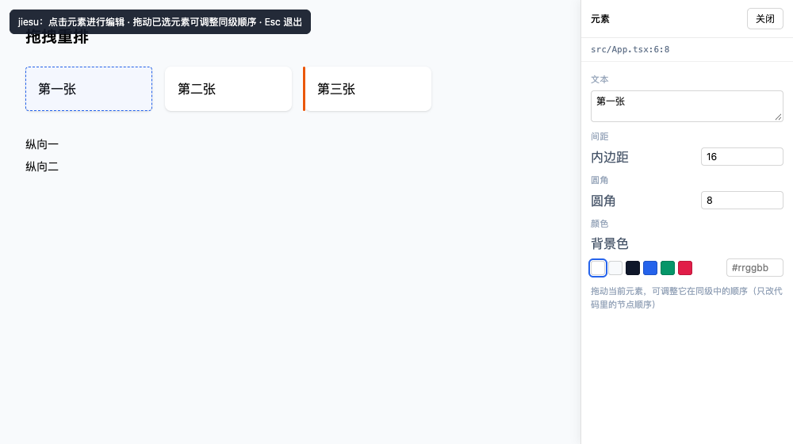

# V0.2 · 拖拽重排（布局语义）实测报告

> 结论先说：**拖拽可以不写任何定位属性，只改代码里的节点顺序。**
> 100/100 用例通过，10 项真实 Chrome 端到端全部通过。

---

## 1. 为什么拖拽是最容易做错的功能

传统可视化编辑器的拖拽 = 把 `left/top` 写到元素上。它立刻能"动"，代价是：

| 后果 | 说明 |
|---|---|
| 响应式被毁 | 桌面端看着对，手机端全乱 |
| 文档顺序与视觉顺序脱节 | SSR / 无 JS / 读屏全错 |
| 代码变脏 | 一屏十几个 `position: absolute`，AI 也难以理解 |

这个项目的第一条纪律是"设计即代码"，所以拖拽必须落到**布局语义**上：
移动 JSX 节点，让 flex / grid 自己重新排版。

---

## 2. 交互设计

| 环节 | 设计 | 理由 |
|---|---|---|
| 何时可拖 | **先选中，再拖**（按住已选中元素内部） | 避免"想选中却拖走了"的误操作 |
| 判定阈值 | 位移 > 5px 才算拖拽 | 5px 以内仍是"点击选中" |
| 拖拽中 | 虚线幽灵框 + 橙色插入线 | 一条线比"卡片跟着鼠标跑"更能说明落点 |
| 横向 / 纵向 | 按父容器 `flex-direction` 决定画竖线还是横线 | 与用户对"往哪插"的直觉一致 |
| 网格 | 按行主序（左→右、上→下）算插入位置 | 网格落位本就由文档顺序决定 |
| 松手 | 顺序没变就什么都不做 | 不产生无意义 diff |
| 拖到容器外 | 灰线提示 + 松手取消并说明 | 跨容器不在当前支持范围，不能默默塞回原容器 |

拖拽是**隐式交互**——不提示没人会尝试。所以选中元素后，面板底部会写一句
"拖动当前元素，可调整它在同级中的顺序（只改代码里的节点顺序）"。



---

## 3. 三层防护，对应三种不同的失效

### 第 1 层：几何层是纯函数（`src/client/drag.ts`）

不碰 DOM，只回答"插到第几个位置"。因此可以脱离浏览器单测：

```
insertionIndexLinear(rects, axis, pointer)   // flex：数中心点在指针之前的项
insertionIndexGrid(rects, pointer)           // grid：行主序比较
planReorder(itemCount, from, insertAt)       // 边界序号 → 新顺序数组
```

刻意处理了"插到自己前面 / 紧跟自己后面"= 顺序不变，避免一次毫无意义的写回。

### 第 2 层：内核校验 DOM 项数与源码子项数是否一致

这是**最容易出事、也最少有人做**的一步。

客户端只能看到渲染后的 DOM 子元素，而源码里的子项可能包含：

```jsx
<div className="flex">
  {items.map((i) => <Card key={i.id} {...i} />)}   {/* 1 个源码子项，N 个 DOM 元素 */}
  {isAdmin && <AdminPanel />}                       {/* 条件渲染，可能根本不渲染 */}
</div>
```

此时"DOM 第 2 项"根本不对应"源码第 2 个子项"。所以 `childOrder` 增加 `expectItems`：

```ts
{ kind: 'childOrder', to: [1, 2, 0], expectItems: 3 }
```

数量不一致就拒绝，并把数字摊开给用户看：

> 页面上有 4 个同级元素，源码里有 2 个子项，索引对不上，已拒绝重排（可能含条件渲染或循环生成的子项）

### 第 3 层：写回后审计产物

沿用 S4 的安全闸：产物里出现 `absolute` / `fixed` / `left-*` / `position:` 就直接拒绝这次改动。
上游逻辑出 bug 也拦得住。

---

## 4. 重排怎么保证"只动该动的"

`reorderJsxChildren` 的技巧是**空白段固定不动，只把项按新顺序填回原槽位**：

```jsx
// 拖拽前
  <div className="w-40">第一张</div>
  <div className="w-40">第二张</div>
  <div className="w-40">第三张</div>

// 把第一张拖到最后
  <div className="w-40">第二张</div>
  <div className="w-40">第三张</div>
  <div className="w-40">第一张</div>
```

缩进与换行 100% 保留，**不需要任何重排缩进逻辑**——因为槽位之间的空白片段本来就没动。
单测直接拿"人工调换三行"的期望文件做逐字节比对。

---

## 5. 实测结果

| 层次 | 用例数 | 内容 |
|---|---|---|
| 几何 | 22 | 横/竖/网格插入位置、边界用例、指示线几何、跨容器判定、阈值 |
| 内核 | 6 | 字节级等价比对、无绝对定位、无 `order-N`、网格重排、数量不一致拒绝、含文本拒绝 |
| 布局（S4 增补） | 3 | 不需要父容器上下文即可重排、`expectItems` 不一致拒绝、非 flex/grid 拒绝 |
| 端到端（真实 Chrome） | 10 | 选中 → 拖拽中出现插入线 → 松手 → 真实文件顺序改变 → 选中态未丢 → 撤销恢复 → 非容器明确拒绝 |

端到端里断言的关键事实：

- 产物 `auditLayoutSafety` 零违规，且不含 `absolute` / `fixed` / `order-\d`
- 三张卡片仍各占一行、缩进仍是 8 空格
- 变更篮记录一条 `调整顺序：第 1 项 → 第 3 位`
- 拖拽结束后选中态还在、面板仍指向 `App.tsx`
- 在 `display: block` 容器里拖拽 → toast「暂不支持拖拽重排」，文件一字节未改

---

## 6. 顺带修掉的问题

| 问题 | 处理 |
|---|---|
| `childOrder` 原先要求调用方传父容器上下文 | 改为**从容器自身 class 推断**（core 能独立判断），服务端路径不再缺上下文 |
| 拖拽后 `changeApplied` 回传的锚点是**父容器**的 | 加条件：只有操作目标就是选中元素时才采用；否则等 HMR 后从 DOM 重读 |
| 只看 className 判断 HMR 是否完成 | 重排后 class 没变、变的是锚点与行号 → 改用"class + 注入属性"签名 |
| 并行跑多组 e2e 抢同一份 vite 缓存 | 每个 demo 独立 `cacheDir` |
| 面板里 `背景色` 标签被色板挤成竖排；`圆角` 混在「间距」下 | 标签独占一行；拆出独立「圆角」分组 |

---

## 7. 明确的限制（不在 V0.2 声称的能力里）

| 限制 | 说明 |
|---|---|
| 跨容器拖拽 | 只是把元素移到另一个父节点，会改变组件结构与层级；需要"新增/删除子节点"能力，属后续版本 |
| 拖边框改尺寸 | 改宽高在不同布局里的正确落点差异极大（flex-basis / grid span / max-w），需单独设计 |
| 容器内含实际文本 | 重排会改变语义（文字与元素穿插），明确拒绝 |
| 父容器不是 flex/grid | block 流里"顺序"就是文档顺序，但用户意图难以判定（可能是想改 margin/float），先不做 |

---

## 8. 下一步候选

1. **拖边框改尺寸**：flex 场景改 `w-*` / `basis-*`，网格场景改 `col-span-*`，同样带安全闸。
2. **跨容器拖拽**：需要 `moveChild`（删除原节点 + 在目标容器按锚点插入），是真正的结构级编辑。
3. **组件替换**：调研阶段评估过"无损替换"风险最高，建议放在有 `moveChild` 之后。
