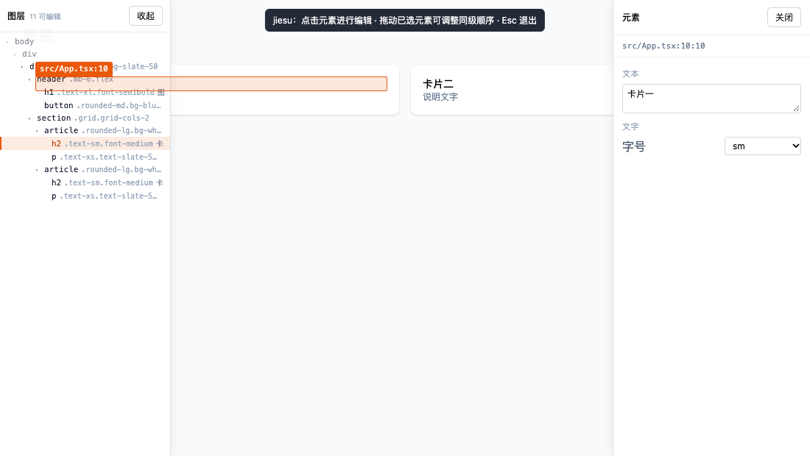

# V0.3 · 图层面板

> 结论先说：**图层面板和画布是同一个选中态的两个入口**，不是两套逻辑。
> 127/127 用例通过，真实 Chrome 端到端 9 项全过。



---

## 1. 为什么用 DOM 树，而不是 JSX 源码树

两种都能做，但取舍不同：

| 方案 | 优点 | 代价 |
|---|---|---|
| JSX 源码树 | 能显示 `<Card />` 这类**组件节点** | 需要向服务端请求 AST、与运行时 DOM 对不齐（条件渲染、循环）、还得做一次映射 |
| **DOM 树（本项目采用）** | 与用户眼睛看到的结构**完全一致**；零请求；每个元素的锚点现成 | 看不到组件节点（`<Card />` 只显示它渲染出的根元素） |

MVP 阶段选 DOM：**用户找元素的依据是"看起来在哪"，不是"代码里叫什么"**。
组件栈留给后续版本（需要服务端参与，见第 7 节）。

## 2. 过滤规则：三层，缺一层树就没法看

```
① 结构噪音      script / style / br / meta … → 跳过
② 覆盖层自己     [data-jiesu-overlay] → 跳过
③ 无意义的叶子   既没有源码锚点、又没有可保留的子元素 → 跳过
```

第 ③ 层是关键，也是最容易做错的一层：

- **不能按"有没有锚点"过滤**：`body`、`#root` 没有锚点，但它们是树根，删了整棵树就没了。
- **不能全留**：第三方库（radix、图表库）会生成大量无锚点的零散节点，全留就是一团噪音。
- 所以规则是：**"没有锚点" 且 "没有子元素" 才丢弃**。这样层级链路完整、叶子干净。

结果：`body > #root > div > header/section` 五层结构完整保留，而库生成的空 div 不出现。

## 3. key 为什么用 DOM 索引链

图层行需要唯一 key 来记住展开状态。第一直觉是用 `data-jiesu-id`（`src/App.tsx#0.1`），**但它是错的**：

```jsx
{items.map((item) => <Card {...item} />)}
```

列表里 3 张卡片 → 3 个 DOM 元素，锚点**全是** `Card.tsx#0`（同一个组件定义、同一个路径）。
用锚点做 key，展开第一张会连带展开另外两张（状态串台）。

所以 key 用 **DOM 索引链** `0.0.2`：由结构决定，天然唯一。
锚点则作为"能不能编辑"的判据（`nosrc` 行显示为半透明，点击明确提示无法编辑）。

## 4. 默认收起：一个被实测打脸的决定

第一版面板默认展开。结果 **V0.2 的拖拽 e2e 直接挂了**——因为面板占掉左侧 232px，第一张卡片的中心点正好落在面板下面，`pointerdown` 打到了覆盖层上，拖拽根本没开始。

这不是 bug，是产品判断问题：

> **这个页面不是我们的画布。** Figma 的面板可以常驻，因为画布是它自己的文档；我们是客人，不该默认遮挡主人的页面。

改成：**左侧常驻一个竖排「图层」标签，主动点开才占空间**（`Alt+Shift+L` 可切）。
这个信息也写进了 CSS 注释和代码注释，避免以后有人"顺手改回默认展开"。

## 5. 双向联动

| 动作 | 结果 |
|---|---|
| 点图层行 | 选中该元素 → 画布高亮 + 右侧属性面板打开 |
| 点画布元素 | 图层树自动展开祖先链、高亮对应行、滚动到可见 |
| 悬停图层行 | 画布画 hover 高亮，但**不改选中态** |
| 关掉属性面板 | 图层树的高亮一起清掉（共享选中态） |
| HMR 改完代码 | 树标记为脏 → 150ms 防抖后重建（class 摘要不会过期） |
| 节点被 HMR 替换 | 指纹找回 + 重建树 + 重新高亮 |

选中逻辑只有一个入口 `selectElement()`——画布点击、点图层、HMR 重绑定都走它。
否则两处状态一定会各自漂移。

## 6. 顺带挖出并修掉的三个真 bug（这版最大的意外收获）

### 6.1 客户端缓存过期行号 → 改错元素（真事故）

现象：S3 的"用户手动改文件导致行号漂移"用例开始在 12 秒后超时，服务端报
「没有找到 spacing 类 gap-12」，而面板上的行号停在 `6:8`（实际已是 `7:8`）。

根因不是服务端定位错了，而是**客户端把行号缓存死了**：

- 我在图层面板里给 `MutationObserver` 加了 `attributes: true`（为了 class 变了标签能刷新）；
- React 一次提交会改很多属性 → observer 疯狂回调 → 每次回调都 `syncSelection()`；
- 而 `syncSelection()` 一进来就 `clearTimeout` 重置轮询计时器；
- 结果**轮询被饿死**，永远等不到"属性稳定"那一刻，面板一直拿着旧行号发出请求。

修法两条：
1. `syncSelection()` 已在等待时**直接返回**，不再重置计时（合并而非重置）；
2. `requestChange()` 在**发送前从活着的 DOM 元素重读锚点**——这是最后一道保险，代价只有一次 `getAttribute`。

### 6.2 定位冲突时"该行唯一就采信行号"是错元素的来源

原规则：双锚点冲突时，若该行只有一个 JSX 元素就采信行号。
但**行号是唯一会因无关编辑而失效的信号**——用户在文件上方加一行，所有行号 +1，
而那一行往往只有一个元素，于是"行号赢了"，改到了另一个元素上。

收紧为：**冲突一律拒绝**，提示重新选择。宁可让用户多点一次，也不改错东西。

### 6.3 字号下拉框从来没生效过

选项是 `xs / sm / base / 2xl…`，而属性的基类是 `text-sm`：

- 比较 `option === prop.base` 永远不成立 → 当前值永远显示第一项；
- 选择后发出 `toBase = "2xl"`，不是合法类名 → 写回必然失败（或静默无效）。

修法：选项直接用完整类名（`text-2xl`），下拉里只显示档位（`2xl`）。
这个 bug 之前一直存在，因为没有任何用例点过字号。

## 7. 明确的限制

| 限制 | 说明 |
|---|---|
| 只有 DOM 层 | 看不到 `<Card />` 这类组件节点；需要服务端 AST + 运行时映射才能做 |
| 无搜索 / 过滤 | 大页面（>1000 节点）只能靠展开逐层找 |
| 不能拖拽改层级 | 拖拽目前只做同级重排（V0.2），跨容器/改父子关系需要 `moveChild` |
| 全量重建 | 每次脏了就整棵重建；超大页面应改成增量 diff |

## 8. 下一步候选

1. **图层搜索**：按标签/类名/文本过滤，直接解决"大页面找不到"——成本低、收益直接。
2. **组件栈**：服务端读 AST 给出组件边界，在图层里插一层"组件节点"，这是 Onlook 的强项，也是我们缺的。
3. **拖拽改层级**：`moveChild`（删原节点 + 目标容器按锚点插入），与 V0.2 的拖拽重排共用同一套几何层。
