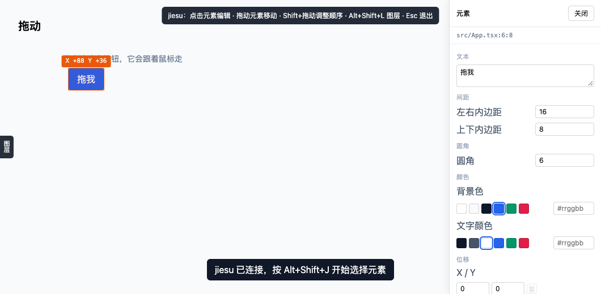
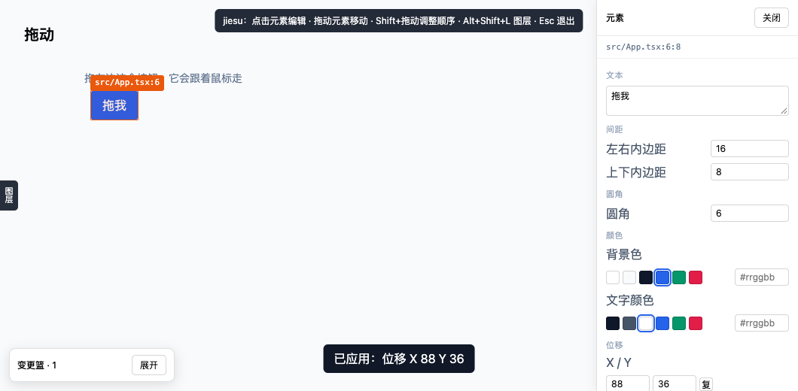

# V0.4 · 拖拽位移：元素真的跟着鼠标走

> 结论先说：**拖动会真的移动元素，但代码里只会多一个 `translate-x-N`，不会出现任何坐标。**
> 151/151 用例通过，真实 Chrome 端到端 7 项全过。





---

## 1. 为什么这次要推翻自己的禁令

V0.2 做拖拽时，我把 `translate-*` 和 `absolute` 一起列进了黑名单。理由是"它是伪绝对定位"。

这个判断有一半是错的：

| 手段 | 是否脱离文档流 | 父容器 | 响应式 | 结论 |
|---|---|---|---|---|
| `position: absolute` | **是** | 塌陷 | 崩坏 | 永久禁止 |
| `translate-x-*` | **否** | 正常参与布局 | 不受影响 | **允许** |

区别不在于"看起来动了"，而在于**元素还在 Flow 里**：兄弟元素照常排版、断点布局照常生效、父容器不会因为子元素消失而塌陷。

所以策略改成：**禁止定位坐标，允许位移语义**。安全闸仍然拦 `absolute / fixed / sticky / relative / left-* / top-* / inset-*` 和内联 `position / left / top / inset / translate`。

## 2. 交互：一个手势两种意图

| 操作 | 结果 |
|---|---|
| **直接拖已选元素** | 元素跟着鼠标走（位移），松手写 `translate-x-N` / `translate-y-N` |
| **Shift + 拖** | 调整它在同级中的顺序（V0.2 的布局语义重排） |
| **Esc（拖拽中）** | 取消位移，代码一个字都不改 |
| 面板「位移」X / Y | 直接输入像素值（吸附到 4px 刻度） |
| 面板「复位」 | 把位移类删干净，回到原位 |

Shift 的按下时机在 `pointerdown` 那一刻决定，拖到一半再按不切换模式——避免手抖改错意图。

## 3. 预览与落地的分工（这是能做到"跟手"的关键）

```
拖动中：element.style.translate/transform  ← 内联预览，60fps 跟手，不碰文件
松手时：计算最终吸附值 → 发送 op → 写 className（translate-x-N）
HMR 后：class 生效 → 再清掉内联预览（不闪回）
```

如果松手就立刻清内联，元素会先跳回原位、等 HMR 应用新 class 再跳过去——用户会看到闪烁。
所以清内联必须等 `className` 真的带上目标位移之后（`settlePendingMove`）。

## 4. 踩到的最深的坑：Tailwind v4 换了属性

第一版预览直接写 `element.style.transform = translate3d(...)`，结果位移翻倍。

原因：**Tailwind v4 的 `translate-x-*` 生成的是 CSS `translate` 属性，不是 `transform`**（v3 是 `transform`）。两条属性会叠加，于是"class 的 40px + 内联的 40px = 80px"。

修法是预览同时压住两条路径：

```ts
element.style.translate = '0px';                                  // 抵消 v4 class
element.style.transform = `translate3d(${x}px, ${y}px, 0)`;       // 覆盖 v3 class，并承载绝对位移
```

同理，测试里判断"元素是否真的位移了"不能只看 `transform`，两个属性都要认。

## 5. 单位：吸附到 4px，而不是自由像素

拖动过程中就把值吸附到 4px 刻度，所以：

- 所见即所得：预览的位置就是松手后的位置，不会跳一下
- 代码干净：写出来是 `translate-x-22`，不是 `translate-x-[87.4px]`
- 负数正确：`snapPx(-6)` 用绝对值取整再还原符号，避免 JS `Math.round(-1.5) = -1` 造成"往左拖 6px 变 4px、往右拖 6px 变 8px"的不对称手感

## 6. 实测

| 层次 | 用例 | 内容 |
|---|---|---|
| 内核 | 15 | 吸附、正负类名、读回、忽略变体前缀、追加/替换/归零、字节级 diff、模板串拒绝 |
| 端到端 | 7 | 拖动跟手 + 数值气泡、源码只多两个类、内联预览被清、面板显示、复位、Esc 取消、无 JS 错 |

端到端里断言的关键事实：

- 拖动中 `inlineTransform` 含 `translate3d(...40px...)`，而**文件此时还没改**
- 松手后文件只多 `translate-x-10 translate-y-3`，`updated.replace(' translate-x-10 translate-y-3','') === original`
- `auditLayoutSafety` 零违规，无 `absolute` / `position:` / `left:`
- 复位后文件**逐字节**回到原样
- Esc 取消后文件一字节未改

## 7. 明确的限制

| 限制 | 说明 |
|---|---|
| 只认静态 `className` 字符串 | `cn()` / 模板拼接 → 明确拒绝（改不了就明说） |
| 只到 4px 粒度 | 更细的位移需要任意值 `translate-x-[3px]`，会脏代码，暂不支持 |
| 只动自身 | 位移不影响兄弟元素位置（这正是与 margin 的区别，也是可预测性的来源） |
| 无对齐辅助线 | 吸附只对网格，不对齐邻居/容器边缘 |
| 不能改尺寸 | 拖边框改宽高仍未做（见下一步） |

## 8. 下一步

1. **吸附辅助线**：拖动到与兄弟/容器边缘对齐时给高亮并吸附——这是"跟手"之后最影响手感的一步。
2. **拖边框改尺寸**：flex 改 `w-*` / `basis-*`，grid 改 `col-span-*`。
3. **位移归组**：把 X/Y 收进"变换"面板，与旋转/缩放一起呈现。
