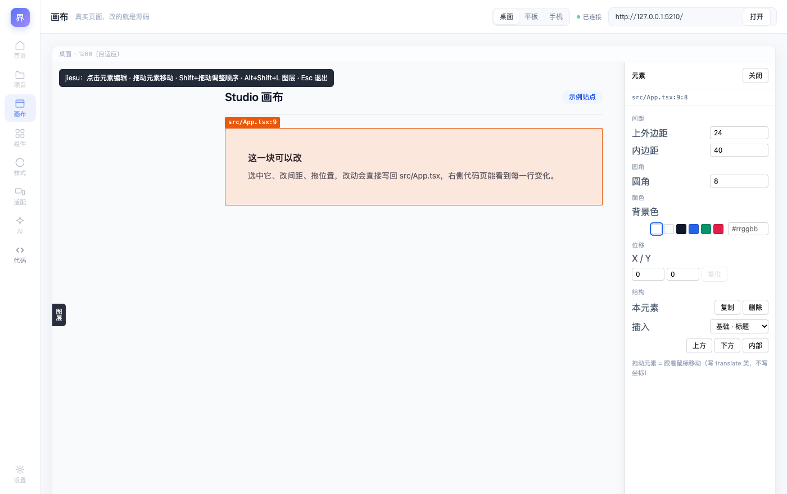
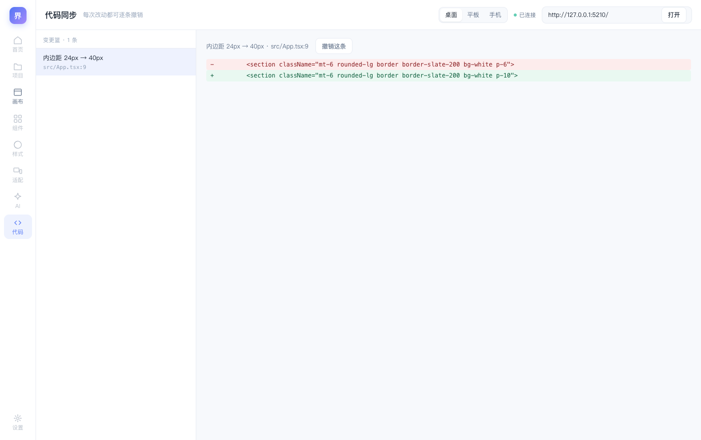
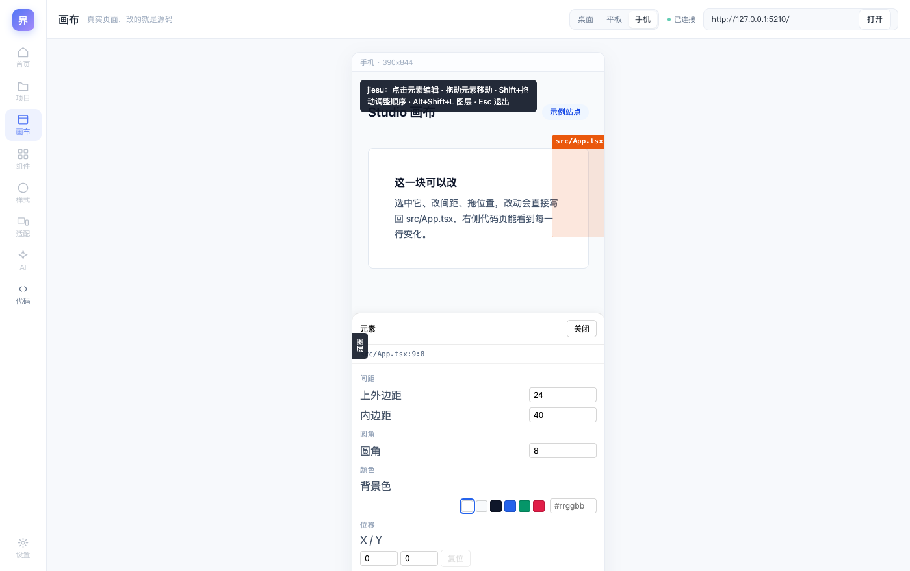

# V0.6 Studio 壳：画布页与代码页接真实数据

> 参考 V2 要的是七页独立应用。这一版先把**最关键的两页做成真的**：
> 02 画布（真实 iframe + 三设备）与 07 代码同步（真实 diff + 逐条撤销）。
> 其余六页诚实标「即将上线」，不做假界面。
>
> 验证：`spikes/v07` 15 个用例（HTTP 7 / 浏览器 7 / 打包产物 1），全量 202/202 通过。

## 一、打开方式

```bash
npx jiesu --root <你的项目>          # 起编辑服务，会打印 Studio 地址
open http://127.0.0.1:<port>/studio
```

顶栏填开发服务器地址（例如 `http://localhost:5173`）→ 点「打开」。
也可以直接带参数进画布：`/studio?url=http://localhost:5173`。



## 二、做了什么

| 区域 | 内容 |
|---|---|
| 左导航 | 72px 通高，八项（首页/项目/画布/组件/样式/适配/AI/代码）+ 底部设置 |
| 顶栏 | 60px：页标题、设备切换、连接状态、地址输入 |
| 画布页 | 真实 iframe 载入你的开发服务器；桌面自适应、平板 834、手机 390 |
| 代码页 | 左侧变更列表、右侧逐行 diff、可逐条撤销 |
| 连接状态 | Studio 自己也连 `/ws`，画布里的改动一落地，代码页立刻刷新 |



### 三层拆分

| 层 | 文件 | 职责 |
|---|---|---|
| 骨架 | `src/studio/shell.ts` | HTML + 设计令牌（CSS 变量唯一真源）+ 导航定义 |
| 前端逻辑 | `src/studio/main.ts` | 页面切换、设备、打开地址、变更列表与撤销 |
| 服务端 | `src/studio/serve.ts` | 静态页 + `/api/state` `/api/changes` `/api/undo` |

纪律沿用内核那套：**前端不维护影子状态**，变更列表与撤销都走 `/api/*`。

## 三、这一版踩到的五个坑（都与"只在真实形态下才出现"有关）

### ① 打包后的 CLI 启动即崩：`Dynamic require of "fs" is not supported`

`studio/serve.ts` 里静态 `import esbuild`（用它做"从源码跑时现场编译"的兜底）。
esbuild 是 CJS 包，被打进 ESM 产物后加载期就抛，**整个 `npx jiesu` 起不来**——
而当时所有测试都是绿的，因为它们全都跑源码。

修法：兜底路径改成 `await import('esbuild')`，构建时把 esbuild 视为外部依赖。
并且新增 `spikes/v07/packaged.test.ts`：**真的 spawn `dist/cli/bin.js`，再访问 `/studio` 与 `/studio/main.js`**。

> 这已经是第三次踩"只测源码、不测产物"（shebang 两遍、覆盖层读不到、esbuild）。
> 现在的规矩是：**每个发布形态的能力，必须有一条真跑产物的测试。**

### ② 画板被裁：1440 的 iframe 塞进 1328 的可视区

两个原因叠在一起：

- `.frame` 在 flex 容器里默认 `flex-shrink: 1` → 1440 被压成 1248
- 用 `justify-content: center` 居中，元素比容器宽时**左右两边都会被裁掉且滚不到**

修法：`.frame { flex: 0 0 auto; margin: 0 auto }`（溢出时 auto 外边距归零，靠左可滚），
并且**桌面画板改为自适应**：`min(1440, 可视区 - 40)`。
不这么改，iframe 右半边（含覆盖层属性面板）就跑到画布外面去了——而面板正是用户要用的东西。

### ③ 窄视口下，268px 的面板盖住 390px 的手机画板

覆盖层原来只有一套桌面布局。切到手机画板后，右侧面板占掉三分之二屏幕。
加媒体查询：`max-width: 640px` 时面板变**底部抽屉**（`max-height: 56vh`），图层宽度改 `min(232px, 74vw)`。



### ④ 色块行把面板撑破

`.jd-sw { flex: 0 0 auto }` 是为了"按钮不被压缩"，但颜色色块有十来个，
它按内容宽度撑出去，后面的色块和 `#rrggbb` 输入框都被切掉。
改为默认 `flex: 1 1 auto; min-width: 0`（允许换行），只有 `.jd-row.actions` 里的按钮行保留 `0 0 auto`。

### ⑤ 视口变化后选中框停在旧坐标

切设备是改 iframe 的宽高，覆盖层不知道，选中框还画在旧位置。
`window.addEventListener('resize', () => paintSelection(...))`。

## 四、当前限制（明确不做假）

| 限制 | 说明 |
|---|---|
| 只有画布与代码页是真的 | 首页/项目/组件/样式/适配/AI/设置 显示"即将上线"占位 |
| 不能在 Studio 里新建项目 | 用 `npx jiesu new <name>`（页面内新建属于"项目"页） |
| 画布一次只开一个页面 | 没有多画板/多实例；跨实例选中同步也未做 |
| 设备切换不改浏览器 UA | 只改 iframe 宽度，不改 UA/触摸模拟 |
| 代码页只显示本次会话的改动 | 没有 git 集成、没有文件全量 diff |

## 五、下一步

1. **组件库页**：把 `COMPONENT_TEMPLATES` 做成可搜索、可预览的列表，拖到画布即插入
2. **项目页**：列目录 + `createProject` 新建 + 一键起 dev server（需要服务端托管子进程）
3. 画布页多实例：三个 iframe 各一个覆盖层，服务端广播同一份选中态（05 适配页的底座）
