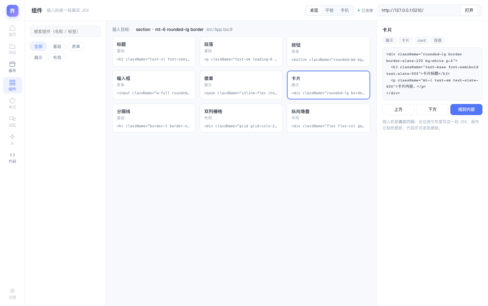

# V0.7 组件库页：插入的是一段真实 JSX

> 组件库页上线（Studio 第三个真页面）。这一版把"从组件库拖组件进来"的产品主线接通了：
> 选卡片 → 选位置 → **往用户的 TSX 里写一段真实 JSX** → 画布热更新 → 代码页可撤销。
> 验证：`spikes/v08` 11 个用例（协议 4 + 浏览器 7），全量 213/213 通过。

## 一、用起来什么样



- **左**：搜索框 + 分组筛选（全部 / 基础 / 表单 / 展示 / 布局）
- **中**：九张模板卡片，标题、分组、一行代码摘要
- **右**：详情——完整 JSX 源码、标签、三个插入按钮（上方 / 下方 / 插到内部）

顶栏的「插入目标」实时显示画布当前选中的元素（如 `section · mt-6 rounded-lg border · src/App.tsx:9`）。
没选中时按钮禁用并说明原因——**插入必须有一个参照元素**，我们不猜"插到页面根"。

## 二、设计决定：为什么卡片上没有"视觉预览"

模板是一段带 Tailwind 类的 JSX，要**真实**渲染它需要用户项目里的 Tailwind 环境。
在 Studio 里硬造一个假预览（内联一份 Tailwind 样式）必然和用户页面上的实际效果不一致——
那是在撒谎。所以：

> **最真实的预览就是画布本身**：插入 → 立刻热更新看到效果 → 不满意在代码页一键撤销。

卡片显示名称 + 一行代码摘要，详情里显示完整源码。选完组件的人本来就要看代码长什么样。

## 三、关键机制：选中态只有一个真源

"插到选中元素下方"需要知道选中了谁。选中态的真源在**覆盖层**（画布里的那个 iframe），
Studio 是画布外面的壳，它看不到 iframe 内部。如果 Studio 也自己记一份"当前选中"，两边迟早漂移——
而插入位置错一次就是改错元素。

所以加了一条协议：

```
覆盖层 --selection--> 服务端（缓存最近一次） --广播--> 所有客户端
新客户端连上时，立刻收到当前值（可能是 null）
```

覆盖层在 4 个时机上报：选中、HMR 后接管新元素、锚点刷新、取消选中。
**每次上报前都从活着的 DOM 重读锚点**——和 `requestChange` 发送前重读是同一条纪律。

Studio 收到后只是订阅者：更新"插入目标"显示，插入时把 locator 原样发给服务端的 `requestStructure`。
插入落地后服务端回传 `select`（新节点锚点），覆盖层接管选中新元素 → 再上报 → Studio 的目标自动跟着更新。
整个闭环不需要 Studio 自己推算任何位置。

## 四、踩到的坑

**① python 脚本改文件"静默失败"**

给 `socket.onmessage` 加 selection 分支时，python 的 `str.replace` 没匹配上（旧文本和我想的不一样），
脚本照样打印了 "patched"——结果新代码没进去，还把一行插到了旧处理器中间。
`selection` 消息被 Studio 完全忽略，而所有测试都过了（协议层测试不经过浏览器）。

> 教训：**批量改文件后必须 grep 验证目标代码真的存在**，不能信脚本自己的输出。
> 这类"改了但没改上"的静默失败，比报错难查得多。

**② Alt+Shift+J 是切换键，不是设置键**

e2e 里连着两条用例都按 `Alt+Shift+J` 进选择模式——第二条把第一条开着的模式**关掉了**，
点击全部落空。修法：测试先读提示条状态，已开着就不再按。
（这类"上一步状态泄漏到下一步"的问题，凡是带切换开关的交互都要防。）

**③ 端口占用让整套 e2e 假失败**

本地演示实例还开着 5210 端口时跑全量，v07 的 e2e 整组被 skip（`EADDRINUSE`）。
表现为"7 skipped"而不是报错，很容易看漏。

## 五、当前限制

| 限制 | 说明 |
|---|---|
| 没有拖拽插入 | 点按钮选位置；拖到画布某个位置落地需要"拖拽预览 + 命中检测"，下一版 |
| 模板不带业务逻辑 | 插进去是静态结构，交互要回代码里写 |
| 插入位置只有前三后一内末 | 没有"插到第 n 个之前" |
| 9 个模板 | 覆盖常用块；做"用户自定义模板"要等项目页 |
| 一次插一个 | 没有多选批量插入 |

## 六、下一步

1. **项目页**：列目录 + `jiesu new` 新建 + 一键起 dev server（服务端托管子进程）
2. **拖拽插入**：从组件库拖卡片到画布，松手位置 = 插入位置（需要画布侧的命中检测与插入线）
3. **画布多实例**：三设备各一个 iframe，同一份选中态广播（05 适配页的底座）
